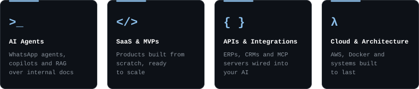

  

 

  

 

  

  
  
  
  
  
  
  
  
  

  
  
  
  <img src="https://img.shields.io/badge/Amazon_S3-0d1117?style=for-the-badge&logo=data%3Aimage%2Fsvg%2Bxml%3Bbase64%2CPHN2ZyB2aWV3Qm94PSIwIDAgMTI4IDEyOCIgeG1sbnM9Imh0dHA6Ly93d3cudzMub3JnLzIwMDAvc3ZnIj4KICA8cGF0aCBmaWxsPSIjZjkwIiBkPSJNMTA4LjU5IDI2LjE0OGMtMS44NTIgMC0zLjYyMi4yMTEtNS4zMDUuNzE1LTEuNjg0LjUwNC0zLjExNyAxLjIyMy00LjM3OSAyLjE4OGExMC44MjkgMTAuODI5IDAgMCAwLTMuMDMxIDMuNDUzYy0uNzU3IDEuMzQ4LTEuMTM3IDIuOTA2LTEuMTM3IDQuNjc2IDAgMi4xODcuNzE2IDQuMjUgMi4xMDYgNi4xMDUgMS4zODYgMS44OTUgMy42NiAzLjMyNCA2LjczNCA0LjI5M2w2LjEwNiAxLjg5NWMyLjA2Mi42NzUgMy40OTYgMS4zOTEgNC4yNTQgMi4xOTEuNzU3LjgwMSAxLjEzNiAxLjc2NSAxLjEzNiAyLjk0NSAwIDEuNzI2LS43NTggMy4wNzQtMi4xOTEgNC0xLjQzLjkyNS0zLjQ5MiAxLjM5MS02LjE0NSAxLjM5MS0xLjY4NyAwLTMuMzI4LS4xNjgtNS4wMTEtLjUwNGEyMy4xMDIgMjMuMTAyIDAgMCAxLTQuNjMzLTEuNDc2Yy0uNDIxLS4xNjgtLjgwMS0uMzM2LTEuMDUxLS40MThhMi4zNTcgMi4zNTcgMCAwIDAtLjc1OC0uMTNjLS42MzQgMC0uOTY5LjQyMy0uOTY5IDEuMzA1djIuMTQ5YTIuOTE5IDIuOTE5IDAgMCAwIC4yNTQgMS4xOGMuMTY4LjM4LjYyOS44IDEuMzA1IDEuMTggMS4wOTQuNjI4IDIuNzM0IDEuMTc5IDQuODQgMS42ODMgMi4xMDUuNTA0IDQuMjk3Ljc1OCA2LjQ4NC43NTggMi4xNSAwIDQuMTI5LS4yOTcgNi4wMjQtLjg4MyAxLjgwOC0uNTUxIDMuMzY3LTEuMzA5IDQuNjcyLTIuMzYgMS4zMDQtMS4wMSAyLjMxNi0yLjI3MyAzLjA3NC0zLjcwNy43MTQtMS40MjkgMS4wOTQtMy4wNyAxLjA5NC00Ljg4MiAwLTIuMTg4LS42MzMtNC4xNjgtMS45MzgtNS44OTUtMS4zMDQtMS43MjctMy40OTEtMy4wNzQtNi41MjMtNC4wNDNsLTUuOTgtMS44OTVjLTIuMjMtLjcxMy0zLjc5LTEuNTE2LTQuNjM0LTIuMzE2LS44NC0uNzk3LTEuMjYxLTEuODA4LTEuMjYxLTIuOTg4IDAtMS43MjYuNjcxLTIuOTUgMS45OC0zLjc0NiAxLjMwNS0uODAxIDMuMTk5LTEuMTggNS41OTgtMS4xOCAyLjk4OCAwIDUuNjgzLjU0NyA4LjA4NiAxLjY0LjcxNC4zMzcgMS4yNjEuNTA4IDEuNTk3LjUwOC42MzMgMCAuOTY5LS40NjMuOTY5LTEuMzQ3di0xLjk4YzAtLjU5LS4xMjUtMS4wNTEtLjM3OS0xLjM5MS0uMjUtLjM3OC0uNjcyLS43MTUtMS4yNjItMS4wNTEtLjQyMi0uMjU0LTEuMDExLS41MDQtMS43Ny0uNzU4YTMyLjUyOCAzMi41MjggMCAwIDAtMi4zOTgtLjY3NmMtLjg4Ni0uMTY4LTEuNzY5LS4zMzYtMi43MzgtLjQ2YTIxLjM0NyAyMS4zNDcgMCAwIDAtMi44Mi0uMTY5em0tODYuODIyLjA4MmMtMi4zMTYgMC00LjUwOC4yNTQtNi41Ny44MDEtMi4wNjMuNTA1LTMuODMxIDEuMTM3LTUuMzAzIDEuODk1LS41OS4yOTctLjk3LjU5LTEuMTguODgzLS4yMTEuMjk2LS4yOTMuOC0uMjkzIDEuNDc2djIuMDYzYzAgLjg4Mi4yOTMgMS4zMDQuODgzIDEuMzA0LjE2OCAwIC4zNzgtLjA0My42NzQtLjEyNS4yOTMtLjA4Ni43OTYtLjI1NCAxLjQ3Mi0uNTQ3YTMzLjQxNiAzMy40MTYgMCAwIDEgNC41NDctMS40MzNBMTkuMTc2IDE5LjE3NiAwIDAgMSAyMC41NDcgMzJjMy4yNDIgMCA1LjUxMy42MzMgNi44NjMgMS45MzggMS4zMDQgMS4zMDMgMS45OCAzLjUzNCAxLjk4IDYuNzM0djMuMDc0Yy0xLjY4My0uMzc5LTMuMjgzLS43MTUtNC44NDMtLjkyNi0xLjU1OC0uMjEtMy4wMzEtLjMzNi00LjQ2MS0uMzM2LTQuMzQgMC03Ljc1IDEuMDk0LTEwLjMxNiAzLjI4Ni0yLjU3MSAyLjE4Ny0zLjgzMiA1LjA5My0zLjgzMiA4LjY3MSAwIDMuMzY4IDEuMDUgNi4wNjMgMy4xMTMgOC4wODYgMi4wNjYgMi4wMiA0Ljg4NyAzLjAzMiA4LjQyMiAzLjAzMiA0Ljk3IDAgOS4wOTctMS45MzggMTIuMzc5LTUuODEzYTM0LjE1MyAzNC4xNTMgMCAwIDAgMS4zMDQgMi40ODQgMTMuMjggMTMuMjggMCAwIDAgMS41MTYgMS45OGMuNDIyLjM4Ljg0NC41OSAxLjI2Ni41OS4zMzQgMCAuNzE0LS4xMjggMS4wOTMtLjM3OGwyLjY1My0xLjc3Yy41NDYtLjQyLjgtLjg0My44LTEuMjYxYTEuODYgMS44NiAwIDAgMC0uMjkzLS45NyAyMi40NjkgMjIuNDY5IDAgMCAxLTEuMzQ3LTMuMDNjLS4yOTctLjkyNS0uNDY1LTIuMTktLjQ2NS0zLjc1aC0uMDg2VjQwYzAtNC42MzMtMS4xNzYtOC4wODYtMy40OTItMTAuMzYtMi4zNi0yLjI3My02LjAyNS0zLjQxLTExLjAzMy0zLjQxem0xOS41OCAxLjAxMmMtLjY3NiAwLTEuMDEyLjM3OS0xLjAxMiAxLjA1MSAwIC4yOTcuMTI5Ljg0NC4zNzkgMS42ODdsOS44OTQgMzIuNTQ3Yy4yNTQuOC41NDcgMS4zODcuODg3IDEuNjQxLjMzNi4yOTcuODQuNDIyIDEuNTk4LjQyMmgzLjYyYy43NTkgMCAxLjM0Ny0uMTI1IDEuNjg0LS40MjIuMzQtLjI5My41OTEtLjg0LjgwMS0xLjY4NGw2LjQ4NS0yNy4xMTcgNi41MjcgMjcuMTZjLjE2OC44NC40NiAxLjM4Ny44IDEuNjg0LjMzNy4yOTIuODgzLjQyMiAxLjY4NC40MjJoMy42MjFjLjcxNSAwIDEuMjYyLS4xNjcgMS41OTgtLjQyMi4zNC0uMjUzLjYzMy0uOC44ODctMS42NEw5MC45NDkgMzAuMDJjLjE2OC0uNDYuMjUtLjc5Ny4yOTMtMS4wNTEuMDQzLS4yNTQuMDg2LS40NjYuMDg2LS42NzYgMC0uNzE1LS4zNzktMS4wNS0xLjA1NS0xLjA1SDg2LjM2Yy0uNzU3IDAtMS4zMDguMTY2LTEuNjQ0LjQyMS0uMjkzLjI1LS41OS44LS44NCAxLjY0TDc2LjU5IDU3LjUxN2wtNi42NTMtMjguMjExYy0uMTY2LS44LS40NjQtMS4zOS0uOC0xLjY0LS4zMzYtLjI5OC0uODg0LS40MjMtMS42ODQtLjQyM2gtMy4zNjdjLS43NTggMC0xLjM0OC4xNjctMS42ODguNDIyLS4zMzUuMjUtLjU4OC44LS43OTYgMS42NGwtNi41NyAyNy44NzYtNy4wNzUtMjcuODc1Yy0uMjUtLjgtLjUwNC0xLjM5LS44NC0xLjY0LS4yOTctLjI5OC0uODQ0LS40MjMtMS42NDQtLjQyM2gtNC4xMjV6TTIxLjY0IDQ3LjQ5NmEzMS44MTYgMzEuODE2IDAgMCAxIDMuOTYuMjUgMzQuNDAxIDM0LjQwMSAwIDAgMSAzLjg3Mi43MTl2MS43NjVjMCAxLjQzNS0uMTY4IDIuNjUzLS40MjIgMy42NjUtLjI1IDEuMDEtLjc1OCAxLjg5NS0xLjQzIDIuNjk1LTEuMTM3IDEuMjYyLTIuNDg0IDIuMTg3LTQgMi42OTUtMS41MTYuNTA0LTIuOTQ5Ljc1OC00LjMzNi43NTgtMS45MzcgMC0zLjQxLS41MDgtNC40MjItMS41NTktMS4wNTQtMS4wMS0xLjU1OC0yLjQ4NC0xLjU1OC00LjQ2NCAwLTIuMTA2LjY3NS0zLjcwNCAyLjA2Mi00Ljg0IDEuMzkxLTEuMTM3IDMuNDU0LTEuNjg0IDYuMjc0LTEuNjg0ek0xMTggNzMuMzQ4Yy00LjQzMi4wNjMtOS42NjQgMS4wNTItMTMuNjIxIDMuODMyLTEuMjIzLjg4My0xLjAxMiAyLjA2Mi4zMzYgMS44OTQgNC41MDgtLjU0NyAxNC40NC0xLjcyNiAxNi4yMS41NDcgMS43NyAyLjIzLTEuOTc2IDExLjYyLTMuNjYzIDE1Ljc5LS41MDQgMS4yNi41OSAxLjc2OSAxLjcyNi44IDcuNDEtNi4yMzEgOS4zNDgtMTkuMjQyIDcuODMyLTIxLjEzNy0uNzU3LS45MjUtNC4zODgtMS43OS04LjgyLTEuNzI2ek0xLjYzIDc1Ljg1OWMtLjkyNi4xMTYtMS4zNDcgMS4yMzYtLjM2OCAyLjEyMSAxNi41MDggMTQuOTAyIDM4LjM1OSAyMy44NzIgNjIuNjEzIDIzLjg3MiAxNy4zMDUgMCAzNy40My01LjQzIDUxLjI4MS0xNS42NiAyLjI3My0xLjY4OS4yOTgtNC4yNTQtMi4wMi0zLjIwNC0xNS41MzMgNi41Ny0zMi40MjEgOS43Ny00Ny43ODggOS43Ny0yMi43NzggMC00NC44LTYuMjczLTYyLjY1My0xNi42MzMtLjM5LS4yMzEtLjc1NS0uMzA0LTEuMDY0LS4yNjZ6Ii8%2BCjwvc3ZnPgo%3D" alt="Amazon S3" />
  
  
  
  

 

  
  

  

  <picture>
    <source media="(prefers-color-scheme: dark)" srcset="https://raw.githubusercontent.com/vanei2002/vanei2002/output/github-snake-dark.svg" />
    
  </picture>

  

